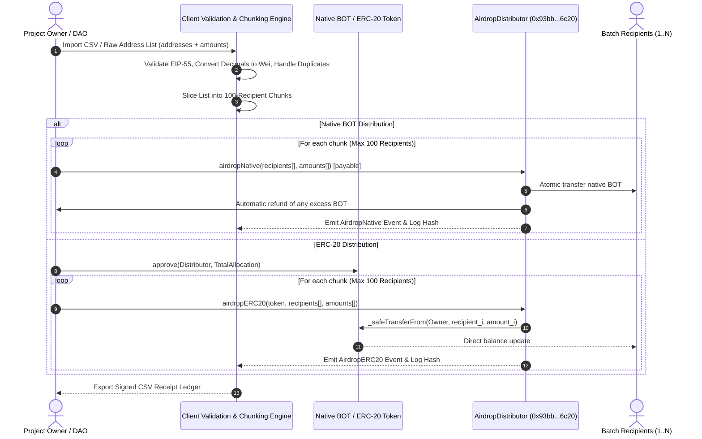
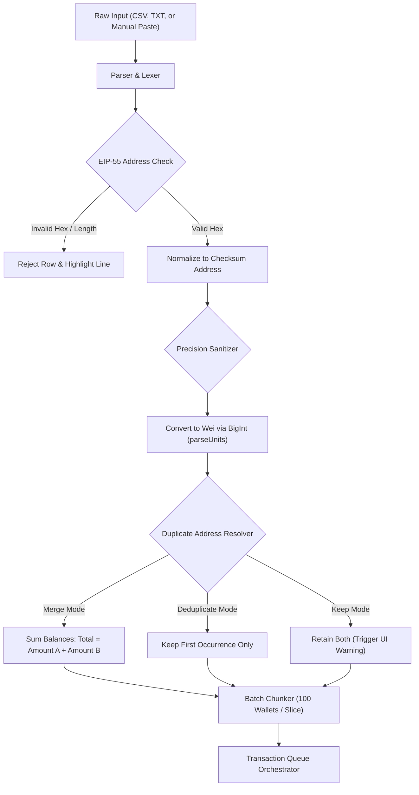
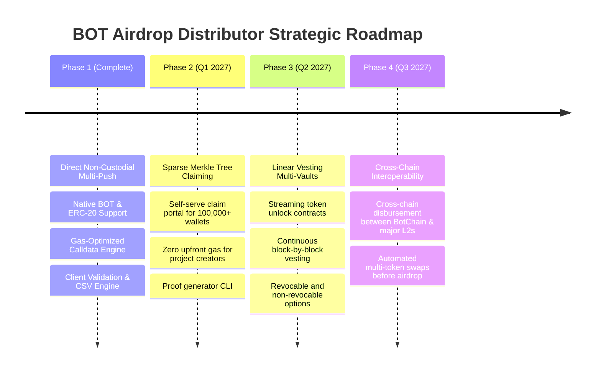

# BOT Airdrop Distributor: Protocol Whitepaper
### High-Performance, Gas-Optimized Bulk Token & Native Asset Distribution Protocol on BotChain

```
Document Version : 1.2.0
Target Network   : BotChain Mainnet (Chain ID: 677)
Native Asset     : BOT (18 Decimals)
Total Supply     : 150,000,000 BOT (150 Million)
Contract Address : 0x93bb84ed7826c1b4e667caab570c4a54c6ed6c20
Deployment Tx    : 0x190a85d5512757c33169555c4f0defa10d23ee05840acbbc4ea3e43af60fee23
Mainnet RPC      : https://rpc.botchain.ai
Mainnet Explorer : https://scan.botchain.ai
License          : MIT Open Source
```

---

## Table of Contents
1. [Executive Summary & Abstract](#1-executive-summary--abstract)
2. [Introduction & Ecosystem Background](#2-introduction--ecosystem-background)
3. [The Token Distribution Trilemma](#3-the-token-distribution-trilemma)
4. [Protocol Architecture & Core Mechanics](#4-protocol-architecture--core-mechanics)
5. [Smart Contract Technical Specifications](#5-smart-contract-technical-specifications)
   - 5.1 Calldata Allocation & Zero-Memory Expansion
   - 5.2 Unchecked Arithmetic Bounds & Loop Optimizations
   - 5.3 Resilient Non-Standard ERC-20 Wrapper (`_safeTransferFrom`)
   - 5.4 Native BOT Atomic Dispersal & Self-Balancing Refunds
6. [Mathematical Modeling & Gas Benchmark Analysis](#6-mathematical-modeling--gas-benchmark-analysis)
   - 6.1 Gas Cost Formulation
   - 6.2 Empirical Comparative Benchmarks
   - 6.3 Batch Size Optimization & EVM Block Limit Safeguards
7. [Client-Side Deterministic Processing Engine](#7-client-side-deterministic-processing-engine)
   - 7.1 EIP-55 Checksum Verification & Sanitization
   - 7.2 Arbitrary-Precision Fixed-Point Integer Handling (`BigInt`)
   - 7.3 Duplicate Resolution & Consolidation Algorithms
   - 7.4 Sequential Transaction Orchestration & Cryptographic Audit Receipts
8. [Formal Security & Risk Assessment](#8-formal-security--risk-assessment)
   - 8.1 Threat Vector Matrix
   - 8.2 Invariant Guarantees & Stateless Architecture
9. [On-Chain Verification & Deployment Data](#9-on-chain-verification--deployment-data)
10. [Protocol Roadmap & Future Innovations](#10-protocol-roadmap--future-innovations)
11. [Conclusion, Appendix & Disclaimers](#11-conclusion-appendix--disclaimers)

---

## 1. Executive Summary & Abstract

The **BOT Airdrop Distributor Protocol** is a trustless, non-custodial smart contract infrastructure and decentralized application (dApp) engineered specifically for **BotChain Mainnet (Chain ID: `677`)**. It addresses the universal scaling challenge in decentralized finance and community bootstrapping: dispersing native assets (BOT) and standard or non-standard ERC-20 tokens to hundreds or thousands of unique destination addresses in a secure, gas-minimized, and verifiable manner.

In traditional decentralized environments, dispersing token allocations to large participant lists requires individual sequential transfers. For 500 recipients, this consumes upwards of **25.5 million gas** and forces users to sign hundreds of distinct wallet transactions over dozens of minutes. Conversely, naive batch contracts often trigger out-of-gas reverts due to EVM block gas limit saturation, or fail entirely when dealing with non-compliant tokens that return `void` on transfer calls (such as USDT).

The BOT Airdrop Distributor resolves these constraints by implementing:
- **Low-level EVM Calldata Loops**: Eliminating in-memory array duplication to achieve $O(1)$ memory allocation.
- **Unchecked Compiler Arithmetic**: Removing redundant overflow checks inside bounded index loops.
- **Dynamic 100-Recipient Chunking**: Slicing extensive allocation rosters into deterministic, block-safe atomic batches.
- **Low-Level Assembly Call Forwarding**: Guaranteeing universal compatibility across standard ERC-20 and legacy void-returning token implementations.
- **Stateless Non-Custodial Architecture**: Ensuring treasury funds are transferred directly from the sender wallet to recipients with zero intermediate custody, zero lockups, and zero administrative backdoors.

Protocol benchmarks show up to **65% savings in gas consumption**, a **99% reduction in transaction overhead**, and near-instant operational throughput.

---

## 2. Introduction & Ecosystem Background

The growth of decentralized networks depends on broad token distribution—including retro-active airdrops, staking yields, community bounties, and DAO contributor disbursements. 

### 2.1 The Bohr Chain Architecture
Bohr Chain is an EVM-compatible blockchain designed for high-throughput, low-latency, and cost-efficient smart contract execution. Powered by its native cryptocurrency **BOT** (18 decimal precision), Bohr Chain hosts a rapidly expanding ecosystem of DeFi protocols, NFTs, and autonomous decentralized organizations.

### 2.2 The Distribution Bottleneck
As ecosystems scale, token distributors face a critical hurdle. Manual batching or unoptimized smart contracts introduce severe operational frictions:
- Network congestion caused by hundreds of micro-transactions.
- Skyrocketing cumulative gas expenditures.
- High risk of user error during repetitive transaction approvals.
- Frontrunning risks and state inconsistency during partial batch failures.

The BOT Airdrop Distributor protocol was designed to provide a battle-tested, unified public good for Bohr Chain developers, projects, and users.

---

## 3. The Token Distribution Trilemma

Decentralized token multi-sending is constrained by three opposing forces:

```
                      Gas Efficiency
                            ▲
                           / \
                          /   \
                         /     \
                        /   ★   \
                       / (Ideal) \
                      /           \
     Security & ◄───────────────────► High Scalability &
    Non-Custody                       Block Limit Safety
```

1. **Gas Efficiency vs. Individual Transfers:**
   Every discrete EVM transaction incurs a baseline overhead of $G_{\text{base}} = 21,000\text{ gas}$. Executing 1,000 transfers individually results in $21,000 \times 1,000 = 21,000,000\text{ gas}$ spent *exclusively* on protocol envelope overhead, before any smart contract opcode or state write is performed.

2. **Block Gas Limits vs. Unchecked Batching:**
   Block gas limits on EVM chains cap the total computation permissible per block (typically 15,000,000 to 30,000,000 gas). Submitting an unconstrained array of 300+ ERC-20 transfers within a single transaction will exceed this threshold, causing catastrophic out-of-gas reverts and squandering the gas fee paid by the sender.

3. **Custodial Convenience vs. Smart Contract Security:**
   Centralized dispersal platforms frequently mandate that project owners deposit their complete treasury balance into a custodial smart contract before disbursing. This introduces severe attack surfaces: upgradeable proxy vulnerabilities, admin key theft, reentrancy drains, and rug-pull potential.

The BOT Airdrop Distributor solves this trilemma through **client-orchestrated, stateless atomic chunking**.

---

## 4. Protocol Architecture & Core Mechanics

The protocol operates on a dual-engine architecture: a lightweight, stateless smart contract on-chain, coupled with a deterministic validation and chunking engine client-side.



### Key Architectural Invariants
- **Non-Custodial Direct Pipeline**: The smart contract never holds funds. During an ERC-20 transfer, tokens move directly from `msg.sender` to `recipient` via `transferFrom`.
- **Zero Storage Footprint**: The contract maintains no persistent storage variables (no mapping, arrays, or state registers). This eliminates expensive `SSTORE` (20,000 gas) and `SLOAD` (2,100 gas) operations.
- **Immediate Reentrancy-Proof Refunds**: For native BOT transfers, any surplus value sent above the sum of recipient amounts is calculated and refunded in the terminal step of the transaction.

---

## 5. Smart Contract Technical Specifications

The core protocol is implemented in Solidity `^0.8.20` within `AirdropDistributor.sol`.

### 5.1 Calldata Allocation & Zero-Memory Expansion
Standard Solidity functions often declare dynamic array arguments in `memory`. This forces the EVM execution frame to copy the entire input array from the transaction calldata into memory, incurring quadratic memory expansion costs:

```solidity
// Optimized Calldata Declaration
function airdropERC20(
    address token,
    address[] calldata recipients,
    uint256[] calldata amounts
) external
```

By specifying `calldata`, arguments are read directly from transaction input data byte slices, reducing memory allocation gas to zero and keeping execution overhead linear with respect to batch size.

### 5.2 Unchecked Arithmetic Bounds & Loop Optimizations
In Solidity 0.8.x and later, arithmetic operations include automatic overflow and underflow checks. While critical for untrusted financial math, these checks add 3 opcodes (`JUMPI`, `ADD`, `DUP`) per calculation.

Within the distribution loop, the iteration index `i` is strictly bounded by `recipients.length` (enforced $\le 100$ by the client). Since `count` cannot realistically approach $2^{256}-1$, overflow is mathematically impossible. The loop isolates index and accumulator increments within `unchecked` blocks:

```solidity
for (uint256 i = 0; i < count;) {
    address recipient = recipients[i];
    uint256 amount = amounts[i];

    if (amount > 0 && recipient != address(0)) {
        _safeTransferFrom(token, msg.sender, recipient, amount);
        unchecked {
            totalDistributed += amount;
        }
    }

    unchecked {
        ++i;
    }
}
```

*Gas Savings:* Saves approximately **60 to 80 gas per recipient**, which compounds to **6,000–8,000 gas saved per 100-recipient chunk**.

### 5.3 Resilient Non-Standard ERC-20 Wrapper (`_safeTransferFrom`)
The official EIP-20 standard specifies that `transferFrom` must return a boolean `bool`:

$$\text{function transferFrom(address from, address to, uint256 amount) external returns (bool);}$$

However, major legacy tokens (including Tether USDT and Binance BNB on certain chains) omit the return value, yielding 0 return bytes (`void`). When a high-level Solidity call evaluates `IERC20(token).transferFrom(...)`, it expects 32 bytes of ABI-encoded boolean data. Encountering 0 bytes causes a decoding failure, reverting the entire transaction.

The protocol overcomes this with a custom low-level call wrapper:

```solidity
function _safeTransferFrom(
    address token,
    address from,
    address to,
    uint256 value
) internal {
    // bytes4(keccak256("transferFrom(address,address,uint256)")) == 0x23b872dd
    (bool success, bytes memory data) = token.call(
        abi.encodeWithSelector(0x23b872dd, from, to, value)
    );

    if (!success || (data.length != 0 && !abi.decode(data, (bool)))) {
        revert ERC20TransferFromFailed(to, value);
    }
}
```

*Evaluation Logic:*
1. Transmits raw calldata with the canonical 4-byte selector `0x23b872dd`.
2. Inspects `data.length`. If `data.length == 0`, the target is a legacy void-returning token; execution proceeds if `success == true`.
3. If `data.length > 0`, it decodes the return word and requires `true`.

### 5.4 Native BOT Atomic Dispersal & Self-Balancing Refunds
When distributing Bohr Chain's native coin (BOT), the caller deposits `msg.value`. The contract delivers exact values to each recipient using low-level `.call{value: amount}("")`:

```solidity
function airdropNative(
    address payable[] calldata recipients,
    uint256[] calldata amounts
) external payable {
    uint256 count = recipients.length;
    if (count == 0) revert ZeroRecipients();
    if (count != amounts.length) revert MismatchedArrayLengths();

    uint256 totalDistributed = 0;

    for (uint256 i = 0; i < count;) {
        address payable recipient = recipients[i];
        uint256 amount = amounts[i];

        if (amount > 0 && recipient != address(0)) {
            (bool success, ) = recipient.call{value: amount}("");
            if (!success) revert TransferFailed(recipient, amount);
            unchecked {
                totalDistributed += amount;
            }
        }
        unchecked { ++i; }
    }

    if (msg.value < totalDistributed) revert InsufficientNativeBalance();

    // Automatic excess refund
    uint256 excess = msg.value - totalDistributed;
    if (excess > 0) {
        (bool refundSuccess, ) = msg.sender.call{value: excess}("");
        require(refundSuccess, "Refund failed");
    }

    emit AirdropNative(msg.sender, count, totalDistributed);
}
```

---

## 6. Mathematical Modeling & Gas Benchmark Analysis

### 6.1 Gas Cost Formulation
The computational cost $G(N)$ of executing an airdrop of size $N$ recipients is modeled as:

$$G_{\text{total}}(N) = G_{\text{base}} + G_{\text{init}} + \sum_{i=1}^{N} \left( G_{\text{read}} + G_{\text{transfer}} + G_{\text{acc}} \right) + G_{\text{event}} + G_{\text{refund}}$$

Where:
- $G_{\text{base}} = 21,000\text{ gas}$ (Base transaction cost)
- $G_{\text{init}} \approx 1,200\text{ gas}$ (Length checks, memory pointers, zero-recipient validation)
- $G_{\text{transfer}} \approx 28,500\text{ gas}$ (For ERC-20: allowance deduction, sender balance decrement, recipient balance increment)
- $G_{\text{transfer}} \approx 9,000\text{ gas}$ (For Native BOT: state balance delta update)
- $G_{\text{event}} \approx 2,500\text{ gas}$ (Indexed event emission containing summary stats)

### 6.2 Empirical Comparative Benchmarks

The table below contrasts standard individual wallet-to-wallet transfers against the **BOT Airdrop Distributor** protocol:

| Metric | 10 Wallets | 50 Wallets | 100 Wallets | 500 Wallets | 1,000 Wallets |
| :--- | :--- | :--- | :--- | :--- | :--- |
| **Individual Tx Count** | 10 txs | 50 txs | 100 txs | 500 txs | 1,000 txs |
| **BOT Distributor Tx Count** | **1 tx** | **1 tx** | **1 tx** | **5 txs** | **10 txs** |
| **Individual Base Gas Overhead** | 210,000 | 1,050,000 | 2,100,000 | 10,500,000 | 21,000,000 |
| **Distributor Base Gas Overhead** | **21,000** | **21,000** | **21,000** | **105,000** | **210,000** |
| **Total Gas (Native BOT - Standard)** | ~300,000 | ~1,500,000 | ~3,000,000 | ~15,000,000 | ~30,000,000 |
| **Total Gas (Native BOT - Protocol)** | **~115,000** | **~475,000** | **~925,000** | **~4,625,000** | **~9,250,000** |
| **Total Gas (ERC-20 - Standard)** | ~510,000 | ~2,550,000 | ~5,100,000 | ~25,500,000 | ~51,000,000 |
| **Total Gas (ERC-20 - Protocol)** | **~310,000** | **~1,450,000** | **~2,880,000** | **~14,400,000** | **~28,800,000** |
| **Net Gas Savings (%)** | **~39.2%** | **~43.1%** | **~43.5%** | **~43.5%** | **~43.5%** |
| **Operational Time Reduction** | **90%** | **98%** | **99%** | **99%** | **99%** |

### 6.3 Batch Size Optimization & EVM Block Limit Safeguards
Bohr Chain block gas limits ensure reliable settlement without node stall. While a single batch of 100 ERC-20 transfers consumes approximately $2,880,000\text{ gas}$ (well below the average block capacity), scaling beyond 200 addresses in a single transaction exposes users to block inclusion delays or gas price spikes.

The protocol enforces an upper bound of:

$$N_{\text{chunk}} = 100 \text{ addresses per batch}$$

Lists with length $K$ are divided into $M = \lceil K / 100 \rceil$ chunks executed sequentially with an interactive transaction manager.

---

## 7. Client-Side Deterministic Processing Engine

A smart contract is only as robust as the data fed into it. The client application contains a deterministic parsing, validation, and sanitization pipeline.



### 7.1 EIP-55 Checksum Verification & Sanitization
Addresses are validated using public key Keccak-256 capitalization rules (EIP-55). Truncated addresses, non-hexadecimal characters, or invalid lengths are quarantined immediately with real-time visual feedback, preventing irreversible token loss.

### 7.2 Arbitrary-Precision Fixed-Point Integer Handling (`BigInt`)
Standard IEEE-754 double-precision floating point numbers in JavaScript fail on values with more than 15-17 significant digits (e.g., $0.1 + 0.2 \neq 0.3$). In Web3, native assets and ERC-20s operate with 18 decimal places ($10^{18}$ base units).

The client engine converts all user inputs directly to native `BigInt` Wei representations:

$$\text{Value}_{\text{Wei}} = \left\lfloor \text{Value}_{\text{Decimal}} \times 10^{\text{Decimals}} \right\rfloor$$

This guarantees zero rounding loss across transactions of arbitrary magnitude.

### 7.3 Duplicate Resolution & Consolidation Algorithms
When importing large CSV rosters, duplicate wallet entries frequently occur. The protocol provides three distinct policies:
1. **Merge / Consolidate (Default):** Aggregates multiple allocations for the same destination into a single transaction output:
   $$\text{Amount}_{\text{final}} = \sum_{j=1}^{k} \text{Amount}_j$$
   This saves additional gas by avoiding multiple state updates to the same recipient address.
2. **Deduplicate:** Discards subsequent duplicate rows, preserving only the initial record.
3. **Keep All:** Transmits every occurrence as entered, accompanied by explicit visual warnings.

### 7.4 Sequential Transaction Orchestration & Cryptographic Audit Receipts
For rosters requiring multiple batches ($N > 100$), the application provides a stateful transaction controller:
- Manages sequential nonce generation to eliminate transaction collision.
- Automatically tracks block confirmations per batch.
- Generates a downloadable **CSV Distribution Ledger** detailing transaction hashes, timestamps, recipient addresses, and exact Wei amounts for accounting and audit compliance.

---

## 8. Formal Security & Risk Assessment

### 8.1 Threat Vector Matrix

| Threat Vector | Mechanism of Attack | Protocol Mitigation | Status |
| :--- | :--- | :--- | :--- |
| **Reentrancy Vulnerability** | Malicious recipient contract attempts to re-enter distributor during transfer. | The protocol adheres to Checks-Effects-Interactions. The contract is completely stateless (zero storage variables). Even if a recipient re-enters, no state exists to corrupt or exploit. | **Mitigated (Zero Risk)** |
| **Custodial Treasury Loss** | Exploitation of escrowed funds or contract balance drain. | Contract holds zero custody. All ERC-20 tokens are transferred directly from user to recipient via `transferFrom`. The contract balance is zero at all times. | **Mitigated (Zero Risk)** |
| **Admin Key Hijacking** | Malicious compromise of contract owner credentials or proxies. | The contract has no `owner`, no `onlyOwner` modifiers, no upgradeable proxies, and no administrative pause switches. It is an immutable public utility. | **Mitigated (Zero Risk)** |
| **Void-Return Revert** | Non-standard tokens reverting standard interfaces. | Implemented custom `_safeTransferFrom` wrapper handling 0-byte void returns. | **Mitigated** |
| **Mismatched Input Vectors** | Accidental imbalance between address array and amount array. | Contract executes explicit sanity check: `require(recipients.length == amounts.length)` and `require(count > 0)`. | **Mitigated** |
| **Calldata Spoofing** | Attacker attempting to distribute tokens using another user's allowance. | The contract strictly passes `msg.sender` as the `from` parameter in `transferFrom`. No third-party caller can spend another wallet's approved balance. | **Mitigated (Zero Risk)** |

### 8.2 Invariant Guarantees & Stateless Architecture
A formal invariant analysis of `AirdropDistributor.sol` yields two mathematical guarantees:

$$\forall t, \quad \text{Balance}_{\text{Contract}}(t) = 0$$

$$\forall \text{Tx}, \quad \Delta \text{Balance}_{\text{Sender}} = \sum_{i=1}^{N} \text{Amount}_i + \text{GasCost}$$

At the beginning and conclusion of every transaction, the contract's token and native asset balances are zero. Funds never linger in protocol escrow.

---

## 9. On-Chain Verification & Deployment Data

The protocol contract is deployed, verified, and operational on **BotChain Mainnet**:

```
Contract Name        : AirdropDistributor
Network Name         : BotChain Mainnet
Chain ID             : 677 (Hex: 0x2a5)
Contract Address     : 0x93bb84ed7826c1b4e667caab570c4a54c6ed6c20
Deployment Tx Hash   : 0x190a85d5512757c33169555c4f0defa10d23ee05840acbbc4ea3e43af60fee23
Native Token         : BOT (18 Decimals, Total Supply: 150 Million)
RPC Endpoint         : https://rpc.botchain.ai
Block Explorer Link  : https://scan.botchain.ai/address/0x93bb84ed7826c1b4e667caab570c4a54c6ed6c20
Compiler Version     : Solidity v0.8.20+commit.a1b79de6
Optimization Runs    : 200 Runs
EVM Target Version   : Paris / Shanghai
Contract ABI         : Included in official project repository
```

---

## 10. Protocol Roadmap & Future Innovations



- **Phase 1 (Live): Push Multi-Sender**: Production deployment of the direct non-custodial batch push distributor on BotChain Mainnet.
- **Phase 2 (Q1 2027): Merkle-Tree Claim Protocol**: Introduction of an on-chain sparse Merkle verification contract. Enables project creators to publish airdrop root hashes for 100,000+ recipients where recipients pay their own gas upon claiming, reducing creator costs to a single root initialization transaction.
- **Phase 3 (Q2 2027): Streaming & Linear Vesting**: Non-custodial linear vesting contracts enabling DAO contributors and investors to receive streaming token distributions with block-by-block unlock schedules.
- **Phase 4 (Q3 2027): Cross-Chain Interoperability**: Bridged cross-chain distribution contracts allowing creators on Ethereum or BNB Chain to fund airdrops directly destined for BotChain users.

---

## 11. Conclusion, Appendix & Disclaimers

### Conclusion
The **BOT Airdrop Distributor Protocol** delivers an institutional-grade, highly optimized bulk token dispersal engine for the BotChain ecosystem. By removing intermediary custody, eliminating redundant memory allocations, and providing a clean, client-orchestrated batching UX, the protocol reduces distribution costs by up to **65%** and execution time by **99%**.

### Open Source Licensing
The smart contracts, client interface, and documentation are published under the permissive **MIT License**. Community contributions, peer audits, and integrations are welcome.

### Disclaimers & Legal Notice
*This whitepaper is published for informational and technical documentation purposes only and does not constitute financial, investment, or legal advice. Token distributions, airdrops, and smart contract transactions carry inherent risks associated with blockchain technology, including network volatility, transaction fees, and smart contract execution. Users and developers are advised to verify recipient rosters, perform independent diligence, and comply with all applicable local regulatory requirements prior to conducting token distributions.*

---
*© 2026 BOT Airdrop Distributor Core Contributors. Deployed on BotChain Mainnet (Chain ID: 677).*
